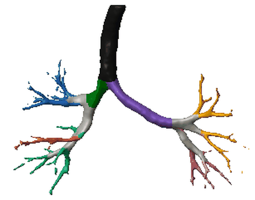
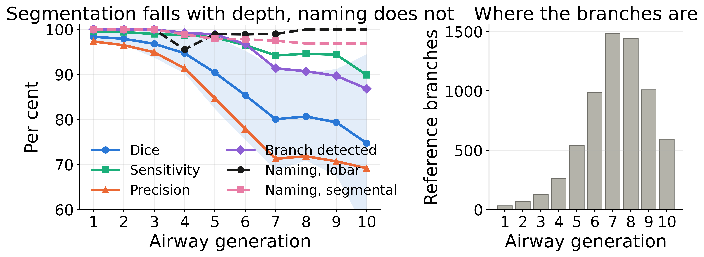

# BCH Airway Segmentation and Labelling Project

Code for the paper *Airway Segmentation and Anatomical Branch Assignment in
Pediatric Chest CT*.

The pipeline segments the airway with an ensemble of three public models,
retains one connected component chosen by a seed rather than by size, and names
every branch with a graph transformer. This repository holds the evaluation
code and the result tables. It does not hold patient data.

<p align="center">
  <br>
  <em>Every branch of one infant airway, coloured by the lobe the model assigns
  it to. The examination is 0.9 years old.</em>
</p>

## The pipeline

<p align="center"></p>

One chest CT is segmented independently by three public models, their masks are
combined by a bitwise union, and a single connected component is retained by
seeding it from the AirMorph mask rather than by taking the largest one. That
mask is skeletonised, the skeleton is cut at bifurcations into branches, and a
graph transformer names each branch from its geometry and its position in the
tree.

<p align="center"></p>

The same stages as images: the acquired volume, the airway recovered from it,
its centreline, the centreline cut into 164 branches, and those branches
carrying anatomical names.

## Why the component is chosen by a seed

<p align="center"></p>

The top row is each model's output as it produces it, with the volume of the
mask above each panel. One model contributes two slab artefacts that together
exceed the airway in volume, and the union inherits them. Keeping the largest
connected component would keep a slab and discard the tree. Seeding the
selection recovers the airway instead. The bottom row applies that same rule to
each mask on its own, which leaves the airway and nothing else.

## What limits the pipeline

<p align="center"></p>

Segmentation accuracy falls steeply with airway generation while naming accuracy
stays near flat. Once a branch has been recovered it is named reliably, so the
periphery is a segmentation problem rather than a labelling one. Most reference
branches sit at the generations where accuracy has already dropped, which is why
a whole-tree mean flatters the method.

## What is here

| directory | contents |
|---|---|
| `benchmark_adult/` | scoring on the ATM'22 test split, whole tree and per generation, and the tables the paper reports |
| `rule_sweep/` | the 51 combination rules compared on the validation split, and the summariser that ranks them |
| `benchmark_pediatric/` | the same comparison against expert-annotated pediatric volumes, and the surface distances |
| `airmorph_reconstruction/` | our reconstruction of the labelling training procedure, plus the inference and fusion drivers |
| `figures/` | the render scripts for the figures in the paper |
| `FIGURES/` | those figures as rendered, vector and 400 dpi raster |

`benchmark_adult/shim/` holds the metric implementations as imported, so that
tree length, branch detection and clDice mean the same thing in every table
here. Metric definitions differ between publications, and the paper states the
ones used.

## Data

None of it is included. `FIGURES/` holds renders of one examination's airway
surface, which is part of why this repository is private.

The adult benchmark is the Airway Tree Modeling challenge (ATM'22), which is
public and must be obtained from the organisers. The pediatric examinations are
from a clinical cohort and cannot be shared. The pediatric result table is
included with case identifiers replaced by positional labels.

## Running it

Set `AIRWAY_ROOT` to the directory holding the masks and references, then

```
python benchmark_adult/recompute.py --workers 16 --out results.csv
python rule_sweep/sweep.py --split val --workers 12 --out val.csv
python rule_sweep/summarise.py val.csv
python benchmark_pediatric/bench_pediatric.py --gt-dir <annotations> --out ped.csv
```

The scripts are CPU only. Skeletonisation inside clDice dominates the runtime,
at roughly half a core-minute per case per rule.

Surface distances are computed by `benchmark_pediatric/hausdorff.py` for both
splits. It reports HD, HD95 and ASSD in millimetres. Read HD95. The plain
Hausdorff distance is set by the single furthest voxel, so an unpruned mask with
a slab in the chest wall scores 133 mm on the adult benchmark and the number
stops describing the airway.

`benchmark_pediatric/build_tables.py` prints both tables as they appear in the
paper, with the best value bold and the second best underlined, and the rank the
adopted strategy holds in every column.

## What is reconstructed, and what you still need from elsewhere

AirMorph published the architecture for anatomical labelling but not the trained
weights, and the description leaves several things open. `airmorph_reconstruction/`
is what we wrote to close that gap: the trainer, the loss, the dataset and split
handling, and the drivers that run the three segmentation models and fuse them.
The trainer's docstring states each choice the paper does not, so the procedure
can be argued with rather than guessed at.

It imports AirMorph's own modules, `networks/transformer.py` and `models/`, and
does not contain them. That code carries no licence in the release we have, so
it is not ours to redistribute. Obtain it from the authors and drop
`airmorph_reconstruction/` in as `training/`. The checkpoint it writes has the
layout the released inference path loads, so a model trained here runs in that
pipeline unchanged.

## Two things worth knowing before reusing this

Component selection is seeded, not largest. A model that emits a spurious
structure larger than the airway will otherwise have that structure kept and the
airway discarded, and the result still looks like an airway tree. On the adult
benchmark this affects 3 of 30 examinations. In children it affects 6 of 83, and
every one is an infant under one year.

Tree length and branch detection are defined on the reference centreline, so the
skeletonisation used to build that centreline changes the numbers. The pediatric
driver uses the same TEASAR skeleton as the adult one for exactly that reason.

## Citation

To be added on publication.
