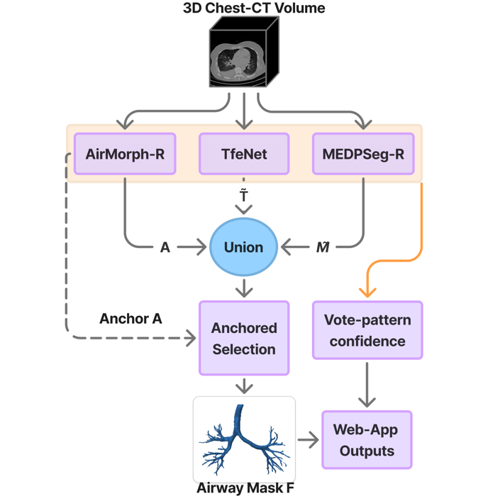
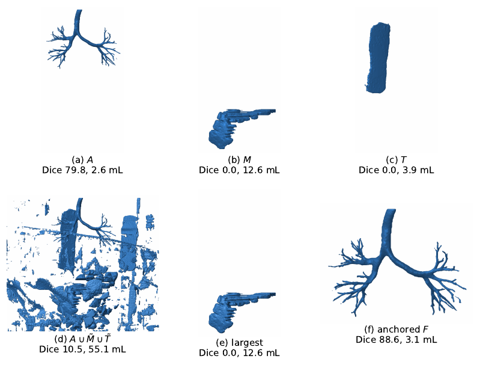
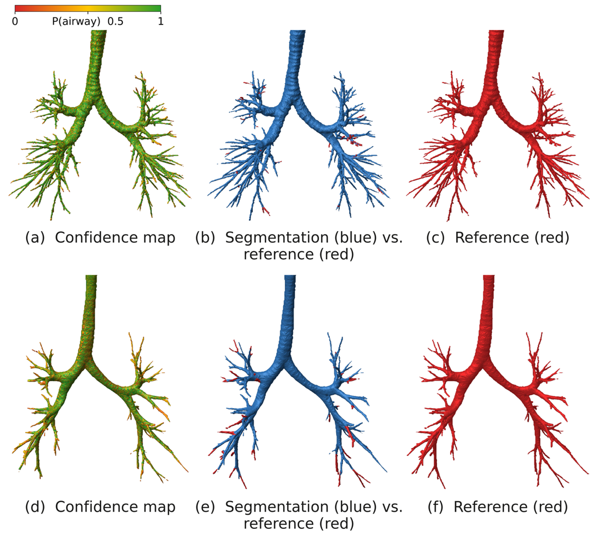

# Anchored union fusion for airway segmentation

Code for the ISBI 2027 paper "Automated Airway Segmentation: A Fusion Model for Both Pediatric and
Adult CT" by Huseyin Umut Isik, Ege Mert Balçık, Duygu Atasoy, Asutosh Sahu, Sila Kurugol and
Şeyda Ertekin.

Airway models trained on adult CT miss different peripheral branches, and their own
largest-component post-processing can keep a non-airway object instead of the airway, which happens
more often on pediatric scans. We combine three models by voxel-wise union of their raw outputs and
keep the connected component that overlaps one trusted member most. No pediatric training is
involved.

<p align="center"></p>

## Method

- AirMorph-R is our reimplementation of the AirMorph segmentation ensemble: five networks trained on
  239 ATM'26 volumes, combined by a 3-of-5 vote and the largest connected component. It gives the
  anchor mask A.
- MEDPSeg-R is MEDPSeg retrained on the same 239 volumes, because the released weights were trained
  on ATM data that likely include our test volumes. TfeNet uses its released BAS checkpoint. Both
  contribute their raw outputs, M~ and T~, before their own post-processing.
- The union U = A ∪ M~ ∪ T~ is reduced to the 6-connected component C that maximizes |C ∩ A|.

Selecting by overlap rather than by size keeps the airway when an artifact is the largest object.
In the infant below, the released post-processing of both MEDPSeg-R (b) and TfeNet (c) keeps a
non-airway object, and so does the largest component of the union (e); the anchored selection (f)
keeps the airway.

<p align="center"></p>

## Results

Mean over examinations; all values in % except HD95 (mm). A, M and T are each model with its own
post-processing. The anchored pairs and the largest component use the same inputs as ours and
change one factor at a time.

| Strategy | Adult DSC | Adult BND | Adult TLD | Adult HD95 | Pediatric DSC | Pediatric BND | Pediatric TLD | Pediatric HD95 |
|---|---|---|---|---|---|---|---|---|
| AirMorph-R (A) | 92.06 | 90.81 | 94.30 | 2.32 | 87.70 | 59.81 | 76.10 | 2.80 |
| MEDPSeg-R (M) | 93.84 | 68.38 | 79.29 | 2.11 | 78.94 | 29.51 | 41.63 | 21.27 |
| TfeNet (T) | 84.44 | 64.96 | 74.94 | 19.06 | 70.06 | 41.87 | 55.90 | 26.54 |
| A ∪ T | 89.83 | 91.86 | 95.03 | 15.46 | 84.32 | 65.97 | 80.37 | 19.12 |
| Majority vote | 94.42 | 76.74 | 85.86 | 1.55 | 79.55 | 41.03 | 58.66 | 3.47 |
| A ∪ M~, anchored | 93.21 | 90.99 | 94.27 | 1.72 | 93.47 | 61.39 | 78.34 | 0.90 |
| A ∪ T~, anchored | 93.29 | 91.58 | 94.80 | 1.75 | 92.21 | 68.15 | 81.80 | 1.30 |
| A ∪ M~ ∪ T~, largest component | 84.73 | 82.23 | 85.32 | 19.00 | 84.31 | 60.99 | 72.77 | 13.99 |
| Ours | 93.24 | 92.05 | 95.09 | 1.77 | 94.15 | 68.79 | 82.52 | 0.70 |

Adults: 30 held-out ATM'26 volumes. Pediatric: nine examinations from Boston Children's Hospital
(not public). The full table with clDice and sensitivity, and the per-generation results, are in
the paper.

Ours detects the most branches in both cohorts. Over the best anchored pair, the third model adds
0.47 percentage points of BND in adults (95% CI 0.31 to 0.64, better in 18 of 30 cases and worse in
none, paired Wilcoxon p < 0.001) and 0.64 in children (better in 6 of 9, worse in none).

The fused mask also carries a voxel confidence derived from the members' vote pattern. Fitted on the
validation volumes, it separates false-positive from true-positive voxels on the adult test set
with an AUROC of 0.891; the 20% least confident voxels hold 85% of the false positives.

<p align="center"></p>

## Contents

- `fusion/anchored_union.py`: the fusion rule and the members' post-processing. Also usable from the
  command line on NIfTI/MHA masks.
- `airmorph_r/`: training code for AirMorph-R. It is used as the `training/` package of a clone of
  the original AirMorph repository (see `airmorph_r/README.md`).
- `medpseg_r/`: data preparation, training and inference for MEDPSeg-R (see `medpseg_r/README.md`).
- `tfenet/predict_tfenet.py`: TfeNet inference; saves the raw and post-processed masks.
- `evaluation/`
  - `table1.py`: Table 1 (members, pairwise unions, majority vote, the three ablations and ours).
  - `stats.py`: paired Wilcoxon tests, Holm correction and bootstrap CIs on the output of `table1.py`.
  - `generation_table.py`, `generation_cldice.py`, `build_generation_table.py`: Table 2.
  - `per_generation.py`: generation assignment used by the Table 2 scripts.
  - `hd95.py`: symmetric 95th-percentile surface distance.
- `confidence/`: the vote-pattern lookup table and the script that fits it on the validation split
  and evaluates it on test.
- `splits/atm26_split.json`: the 239/30/30 partition of the ATM'26 Task-1 training data.

## Usage

Fusing three masks that share a grid:

```
python fusion/anchored_union.py --anchor airmorph_r.nii.gz \
    --others medpseg_r_raw.nii.gz tfenet_raw.nii.gz --out airway.nii.gz
```

Reproducing the adult tables. Masks are stored as one `ATM26_<id>.npz` per case: AirMorph-R from
`airmorph_r/dump_airmorph_masks.py` (keys `raw`, `post` and the five member votes), MEDPSeg-R from
`medpseg_r/predict_medpseg_r.py` and TfeNet from `tfenet/predict_tfenet.py` (keys `raw`, `post`).
The evaluation scripts import the ATM'22-style metrics from the AirMorph clone, so run them from
there:

```
python evaluation/table1.py --split test --airmorph DIR --medpseg DIR --tfenet DIR \
    --labels ATM26/labelsTr --centerlines CENTERLINE_CACHE --out results/table1_test.csv
python evaluation/stats.py results/table1_test.csv

export ATM26_LABELS=... ATM26_CENTERLINES=... AIRMORPH_MASKS=... MEDPSEG_MASKS=... TFENET_MASKS=...
python evaluation/generation_table.py --out-dir results/generation
python evaluation/generation_cldice.py --out-dir results/generation
python evaluation/build_generation_table.py results/generation > table2.tex
```

## Related tools

- Web application: upload a CT volume and receive the airway mask, centerline, branch measurements
  and confidence map (about ten minutes on one NVIDIA A10G GPU).
- ITK-SNAP extension for 3D editing of airway segmentations:
  https://github.com/HUmutI/itksnap-3d-edit

## Data, dependencies and weights

The ATM'26 data are not redistributed; they are available from the challenge. AirMorph, MEDPSeg and
TfeNet are not included: install `medpseg` as a package and clone the AirMorph and TfeNet
repositories. See `NOTICE.md`.

Trained weights will be added once the licence terms of the original models and the ATM'26 data
have been checked.
