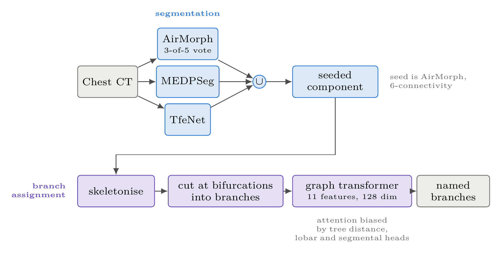

# BCH Airway: segmentation, branch naming and morphometry in pediatric chest CT

Everything current in the airway project, in one place: the pipeline that
segments and names the airway tree, the scripts that measured the cohorts,
the evaluation code behind the paper, the paper source, and the web app that
runs the pipeline for radiologists. No scans, masks or patient tables are in
here, only code and documentation.

Start with this file. Every directory has its own README that goes deeper.

## What the method does

One chest CT is segmented independently by three public models (AirMorph,
MEDPSeg, TfeNet). Their masks are combined by a bitwise union, and a single
connected component is kept by seeding it from the AirMorph mask rather than
by taking the largest one. That mask is skeletonised, cut into branches at
bifurcations, and a graph transformer names every branch (trachea, lobar,
segmental). Per-branch measurements (length, diameters, angles, generation)
follow from the named tree.

<p align="center"></p>

## Map of the repository

| directory | what | start at |
|---|---|---|
| `pipeline/` | the cohort pipeline: set up the three model environments, run all stages over a dataset tree, fuse, QC, morphometry | `pipeline/README_RUN.md` |
| `webapp/` | the website: upload a NIfTI, get mask + labels + viewer + morphometry; Docker images and the AWS runbook | `webapp/README.md`, `webapp/handoff_website.md` |
| `models/` | how to obtain the three model tarballs (code + weights), what was changed in them, licences | `models/README.md` |
| `cohort90/` | selection, measurement and report of the 90-scan normative cohort | `cohort90/README.md` |
| `evaluation/` | benchmark against ATM'22 and pediatric annotations, the fusion-rule sweep, the labelling reconstruction, paper figures | `evaluation/README.md` |
| `paper/` | LaTeX source of the method paper | `paper/README.md` |
| `docs/` | how this maps onto the lab machine izmir; conventions | `docs/izmir.md` |

## Three ways to run it

**1. Docker, one scan, any machine with an NVIDIA GPU (≥ 16 GB) and Docker.**
The only path that needs nothing from izmir.

```bash
git clone https://github.com/quin-med-harvard-edu/airway-seg-and-labelling.git bch-airway && cd bch-airway
gh auth login                                            # your own GitHub account; it must have access to this private repo
./models/download_models.sh webapp/deploy/vendor        # 3 tarballs, 520 MB, from the repo's Release
cp pipeline/fuse_union3.py webapp/deploy/vendor/
mkdir -p webapp/deploy/vendor/scripts && cp pipeline/scripts/09_airmorph_morphometry.py cohort90/axis_geometry.py webapp/deploy/vendor/scripts/
cd webapp
docker build -f deploy/Dockerfile.worker -t airway-worker .    # 30–45 min, 20 GB
docker build -f deploy/Dockerfile.api    -t airway-api .
mkdir -p /tmp/jobs && docker run -d -p 8000:8000 -v /tmp/jobs:/jobs airway-api
docker run --rm --gpus all --shm-size 8g -v /tmp/jobs:/jobs airway-worker
```

Open http://localhost:8000, upload a de-identified NIfTI. About 17 minutes
per scan on an A5000/A10G. `webapp/deploy/README_AWS.md` turns the same two
images into a website.

**2. On izmir, natively.** The environments, models and data are already
there. `docs/izmir.md` says where. In short:

```bash
cd /fileserver/external/quin/ege/bch-airway/pipeline/scripts
./run_pipeline.sh pilot                 # 13 cases, ~1 h; read stage 6 and 7 output
```

and for the website `cd ../../webapp && ./run_api.sh` plus `./run_worker.sh`
in a second terminal, outside the sandbox.

**3. On a new machine, natively.** `models/download_models.sh`, then
`pipeline/scripts/00_setup.sh` builds the three virtual environments (they
have conflicting dependencies, hence three) and compiles TfeNet's CUDA ops.
Set `OR3_BASE`, `OR3_DATASET`, `OR3_OUT` in the environment or edit
`pipeline/scripts/config.sh`; every path in the pipeline derives from those.
Needs nvcc 12.4 and a matching driver.

## Rules

- **Research use only. No PHI.** Only de-identified NIfTI enters any of this;
  the web pages say so on every screen. Never commit a scan, a mask, a
  spreadsheet with per-patient rows, or a mapping file. `.gitignore` blocks
  the obvious extensions but is not a substitute for looking.
- Our code is MIT licensed (`LICENSE`). The three model tarballs in the
  Release also carry third-party code and weights (MEDPSeg, TfeNet, the
  AirMorph segmentation models) under their authors' terms; check those
  before making the repository or the Release public. `models/README.md`.
- Fusion connectivity is 6 and fixed across a cohort (`config.sh`).
  Component selection is seeded, never largest. Both are explained in
  `pipeline/README_RUN.md` and `evaluation/README.md`.

## Status, 2026-09-23

- Cohort of 849 scans segmented; 83 normals measured; a 90-scan balanced
  normative cohort selected, measured and reported (`cohort90/`).
- Method paper drafted (`paper/`), evaluation complete (`evaluation/`).
- Web app working on izmir; Docker images built and verified bit-identical
  to the native run; AWS deployment prepared and waiting on an account
  (`webapp/handoff_website.md`, "Where it stands").

## Where the repository lives

Canonical: https://github.com/quin-med-harvard-edu/airway-seg-and-labelling
(the lab organisation). Mirror: https://github.com/HUmutI/bch-airway. Both
private; both carry the `models-v1` Release. Push to both
(`git push origin main && git push bch main` from the izmir checkout).

## People

Umut Işık (author of all of this; huseyinumut2004@gmail.com), QUIN lab,
Boston Children's Hospital / Harvard Medical School. Supervisor: the lab PI.
